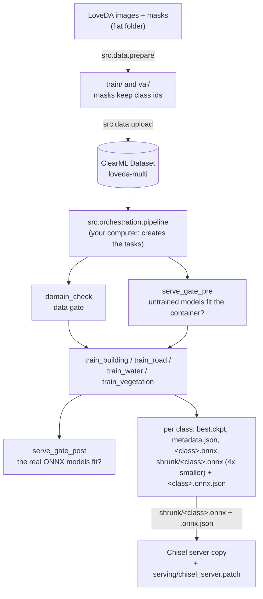

# Per-class segmentation for the Chisel server (Hydra + ClearML + Kaggle)

Trains **one semantic-segmentation model per class** (building, road, water, vegetation) on LoveDA, checks the data
and the serving cost **before** spending GPU time, and exports each model as ONNX with a threshold file that the
Chisel server reads. The handbook, with what is Verified and what is Untested, is [docs/GUIDE.md](docs/GUIDE.md).

## The flow

### 1. From raw data to models in the server



- Every box after the pipeline is a **ClearML task** that a GPU agent runs (here: a Kaggle notebook,
  `kaggle/start_agent.py`). Each task is a clone of a registered **base task**, pinned to a git commit.
- A gate that fails exits with code 2, so the steps after it are never created.
- `serve_gate_pre` uses untrained models: they cost the same to run as trained ones, so an architecture that can never
  fit the container (4 vCPU request, 8 vCPU limit, 8 GiB for all four models) is stopped before training.

### 2. Inside one training task (`src/training/train.py`)

```
Hydra composes conf/  ->  init_clearml (Task, editable "Overrides", recompose)  ->  dataset (ClearML or local folder)
  ->  preflight gate (skipped in the pipeline: domain_check already ran)  ->  Lightning training (best by val/iou)
  ->  sweep: every TTA x threshold on val  ->  ONNX export + sidecar (threshold at TTA "none")  ->  shrunk ONNX
  (src/shrink.py, the production file)  ->  IoU of both through the server's path  ->  metadata.json
  ->  upload artifacts
```

### 3. The order in which you run things

| When | Command |
|---|---|
| once | `pip install -r requirements.txt` and `clearml-init` |
| once per data version | `python -m src.data.prepare --src data/loveda --out data/loveda_multi` |
| | `python -m src.data.upload --path data/loveda_multi --name loveda-multi` (prints the dataset id) |
| optional, any time | `python -m src.training.train clearml.enabled=false data=water data.root=data/loveda_multi train.epochs=1` |
| after every `git push` | register the base tasks, with **no extra arguments**: `python -m src.gates.domain_check`, `python -m src.gates.serve_gate`, `python -m src.training.train` (may be stopped after ~80 s); archive the old ones |
| every Kaggle session | start the agent: `kaggle/README.md` |
| each experiment | `python -m src.orchestration.pipeline --dry-run`, then `python -m src.orchestration.pipeline --local --queue kaggle --param data.clearml_dataset_id=<id> --train-param train.epochs=30 --train-param train.batch_size=4` |
| by hand | `python -m src.export_onnx ...`, `python -m src.shrink in.onnx out.onnx`, `python -m src.gates.serve_check --models <folder>`, `python tests/test_postprocess_semantic.py` |

Settings are Hydra overrides (`key=value`); in zsh quote brackets, e.g. `'sweep.tta=[none]'`. A setting can be changed
from ClearML (UI, pipeline, HPO) only if its key is in `clearml.tunable` in `conf/config.yaml`.

## What each folder does

```
conf/                     Hydra configuration: the single source of truth for every setting
  config.yaml               defaults, training/sweep/export settings, the `tunable` keys ClearML may override
  data/                     which mask ids form each class: building, road, water, vegetation (one model each),
                            loveda (all four in one model), buildings (legacy binary masks)
  architecture/ encoder/    the network (Unet, FPN, DeepLabV3+) and its encoder + pretrained weights
  loss/ preflight/ serve/   loss weights, the data-gate limits, the serving-gate limits (production container)
src/
  common/                   shared helpers
    clearml_utils.py          ClearML <-> Hydra glue: Task.init, "Overrides", recompose, fail a gate
    envinfo.py                container CPU/memory limits and peak memory of a process
  data/                     everything about the data
    tiles.py                  the dataset: image -> tensor (RGB / 255), mask -> one binary channel per class
    prepare.py                LoveDA flat folder -> train/ and val/ (random split per tile, seeded)
    upload.py                 a train/val folder -> a versioned ClearML Dataset
  training/                 one training run
    train.py                  the entry point (flow 2 above)
    module.py                 LightningModule: BCE + Dice loss, IoU/F1 per class
    sweep.py                  after training: best test-time augmentation and threshold per class
    metadata.py               metadata.json: config, package versions, checkpoint hash, sweep results
    logger.py                 sends Lightning's metrics to ClearML
  gates/                    checks that stop a pipeline early (exit code 2)
    domain_check.py           the data gate as a ClearML task
    preflight.py              the data checks: train/val domain shift, label balance per class
    serve_gate.py             the serving gate as a ClearML task (before and after training)
    serve_check.py            the measurement: all models in one process, the server's threads and tiles
  orchestration/            runs many tasks
    pipeline.py               the per-class ClearML pipeline (flow 1 above)
    hpo.py                    Optuna hyperparameter search over the train task (untested)
  export_onnx.py            checkpoint -> <class>.onnx + <class>.onnx.json (sigmoid output, server's input format)
  shrink.py                 store the ONNX weights as int8 (about 4x smaller file, same latency)
  model_factory.py          builds the network with segmentation_models_pytorch, loads encoder weights
  export_weights.py         saves pretrained encoder weights to a file, for training without internet
serving/                  what the Chisel server needs
  postprocess_semantic.py   drop-in for the server's YOLO post-processing: probabilities -> 0/255 mask per tile
  chisel_server.patch       the change to the server's server.py: semantic models use their sidecar threshold
tests/                    test_postprocess_semantic.py: the post-processing inverts the server's own letterbox
pipeline/pipeline.yaml    the pipeline: base task names, queues, architecture + encoder per class
kaggle/                   start_agent.py turns a Kaggle GPU notebook into a ClearML agent (queue `kaggle`)
hpo/space.yaml            the HPO search space
offline/                  drafts for an environment without internet: Dockerfile, wheelhouse script (untested)
docs/GUIDE.md             the handbook: why it is built this way, step by step, troubleshooting, what is proven
```

## Where the project stands

Verified: the whole per-class pipeline on Kaggle (1 epoch: val IoU water 0.70, vegetation 0.59, building 0.53,
road 0.48), ONNX = PyTorch, the models inside a copy of the server, and latency/memory under docker limits (faster and
smaller than the current YOLO models). Not yet: full-length training, a real production image, small crops (they fail
when the server enlarges them more than about 2x), production hardware. Details: docs/GUIDE.md, section 5.5.
