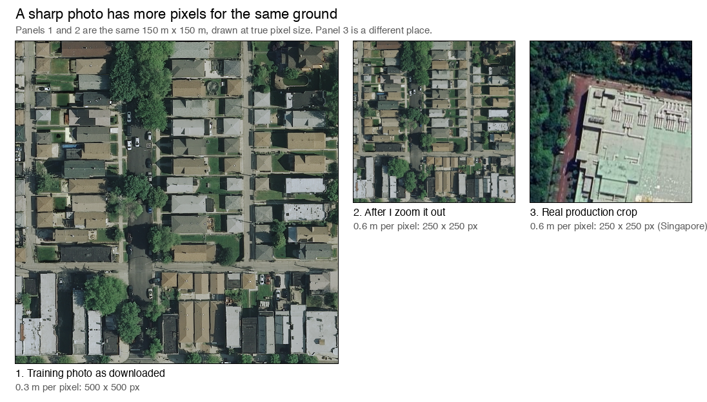

# Dataset checklist: what to look for before training

For any image-segmentation dataset, before you train on it. The first part is the three checks that decide most
outcomes (**GSD, region, balance**); the rest is the full list. The appendices hold what is specific to the Chisel
pipeline and to the datasets checked so far.

How to use it: fill in the profile (section 1), go through the checks (section 2), then copy the sign-off (section 5)
and keep it with the dataset.

## 0. Words used in this document

If a word is new, it is here.

| Word | Plain meaning |
|---|---|
| **Photo, tile** | One downloaded aerial or satellite image. |
| **Crop, square** | A small square cut from a photo. The model trains on these. |
| **Mask, label** | A second image, the same size as the photo, where each pixel says what it is: road, water, building and so on. |
| **Class** | One kind of thing the model must find, such as "road". |
| **GSD** | Ground sampling distance: how many metres of ground one pixel covers. 0.3 m means a pixel is 30 cm wide. A smaller GSD captures smaller physical shapes and boundaries (spatial clarity). |
| **Bit depth** | How many brightness levels one pixel can store for each colour. 8 bits is 256 levels (0 to 255), 12 bits is 4,096, 16 bits is 65,536. More bits capture subtler levels of light and shade (dynamic range), so details do not disappear into pure black or blown-out white. |
| **Resample** | Change a photo's pixel size, which is like zooming in or out. |
| **Nearest neighbour** | A way of resizing that copies the closest pixel instead of blending. Used for masks so "road" never blends into "building". |
| **Train and val** | Train is what the model learns from. Val (validation) is held back to check how well it learned. |
| **Leakage** | When val photos are too similar to train photos, so the check looks better than the model really is. |
| **IoU** | A score from 0 to 1 for how well the predicted area overlaps the true area. 1 is perfect. |
| **Precision** | Of the pixels the model marked as "road", how many really are road. Low precision means it invents things. |
| **Recall** | Of the pixels that really are road, how many the model found. Low recall means it misses things. |
| **F1** | One score that balances precision and recall (their harmonic mean). It is high only when both are high. |
| **Region** | A city or an area. Splitting by region means whole cities are held back. |
| **Domain shift** | How different two sets of photos look from each other (colour, light, place). |
| **Epoch** | One full pass through all the training squares. |
| **Nadir** | Looking straight down. Off-nadir means the camera was tilted. |

## 1. The big three

### GSD: how big is one pixel on the ground

Ground sampling distance, in metres per pixel. A model learns what a road or a roof looks like *at one scale*. If
the dataset is 0.3 m per pixel and the images you will run it on are 0.6 m, every object is half the size the model
learned, and IoU drops with no error to tell you why.

- **Look for:** the dataset's GSD (from its documentation and from the files), and the GSD of the images the model
  will really see. Rule of thumb: within about 25% is usually fine; a factor of 2 is a problem.
- **Check:** `rasterio.open(f).transform` gives the pixel size (`a`, `e`). In a projected CRS it is in metres; in a
  geographic CRS it is in degrees (about 111,320 m per degree north-south). Look at a few files from every region:
  a dataset can mix 0.25, 0.3 and 0.5 m.
- **Fix:** resample every tile to the target GSD before training: images with area averaging when shrinking, masks
  with nearest neighbour so ids stay ids. Do not mix GSDs in one training set without resampling or scale augmentation.
- **Remember:** upscaling does not add detail. A 1 m source resampled to 0.3 m is a blurry 0.3 m image.

**Two different ways a photo can be "better".** They are independent, and a model needs both to match what it will see:

| | Measures | More or smaller gives you | In Chisel |
|---|---|---|---|
| **GSD** (spatial) | metres of ground per pixel | **Smaller GSD:** captures smaller physical shapes and boundaries (spatial clarity) | 0.55 to 0.6 m |
| **Bit depth** (brightness) | levels of light per pixel and colour | **More bits:** captures subtler levels of light and shade (dynamic range), so details do not disappear into pure black or blown-out white | 8 bits (256 levels) |

A smaller GSD does not give more shades of grey, and more bits do not make objects bigger. A 16-bit photo at 0.6 m
still shows a 0.6 m world, only with finer tones. If a dataset has more bits than production sends, the extra tones
must be squeezed to 8 bits the same way in training and in production (2.2, "Bit depth above 8").

**What "within about 25%" means, with an example.** Networks tolerate a modest change in object size, because of
augmentation and because convolution layers pool over neighbouring pixels. Say the training set is 0.40 m per pixel,
and a house spans 20 pixels in it:

| Images at run time | Change from 0.40 m | The same house spans | Verdict |
|---|---|---|---|
| 0.30 m per pixel | 25% finer | about 27 pixels | Fine: the layers bridge this |
| 0.50 m per pixel | 25% coarser | 16 pixels | Fine |
| 0.80 m per pixel | 100% coarser | 10 pixels, a quarter of the area | Too far: confidence falls off sharply |

The 25% is a rule of thumb, not a measured limit; test it on your own data. In this project the models were trained
on LoveDA (0.3 m) and production is 0.6 m: a 100% change, the same case as the last row.

### Region: does it look like where the model will run

A model generalises to places that look like its training data: the same kind of buildings, vegetation, roads, soil,
light, season and sensor. A dataset of European cities can score well and still fail on a tropical one.

- **Look for:** which regions, climates and scene types the dataset covers, and how they compare with your target
  area. Write down the closest match and the biggest gap (for example "no tropical dense urban").
- **Check:** open 30 tiles per source region and 30 images from the target and compare them by eye; compare the
  mean and standard deviation per colour channel. Same sensor, season and viewing angle? Shadows, haze, clouds?
- **Also:** how many regions there are (75 regions is better than 3 for the same number of tiles) and whether any one
  region dominates the tile count.
- **Fix:** add data from the target area, even a small set; weight or filter regions; at minimum keep a held-out set
  from the target area to measure with (2.5).

### Balance: how much of each class is there

Classes are rarely equal. If 2% of pixels are water, a model that predicts no water scores 98% pixel accuracy.

- **Look for:** pixel share per class and per split; the share of tiles with none of a class; the share of tiles
  where a class covers most of the tile.
- **Check:** count class pixels over the masks (a few thousand tiles is enough). Compare train with val.
- **Fix:** loss weighting (`pos_weight`), a loss that favours rare classes and sharp edges (Dice, or Focal), one model
  per class, oversampling or filtering tiles (2.6). Watch IoU per class, never only the average.
- **Expect:** a region-based split shifts the shares a little (cities differ); a random per-tile split hides it.

### Profile: write these down before anything else

| Item | Value |
|---|---|
| Dataset, version, download date | |
| GSD (per region if it varies) | |
| Regions or countries, and how many | |
| Sensor or source, season, years | |
| Bands, bit depth, file format | |
| Tile size(s), number of images | |
| Classes and their ids | |
| Pixel share per class (train / val) | |
| Tiles with none of each class | |
| Split method, seed | |
| License | |

## 2. The full checklist

### 2.1 Rights and source

- [ ] The **license** allows your use. Production use of a model trained on the data counts as use.
- [ ] **Provenance** is known: who made it, which imagery, how the labels were made.
- [ ] Nothing **sensitive** is in the images or file names.
- [ ] You have the **exact version**: a download date or version number, and a copy or a way to get it again.

### 2.2 Does it match the target (see the big three)

- [ ] **GSD** matches, or is resampled to match.
- [ ] **Region and scene types** resemble the target; the gap is written down.
- [ ] **Bands and range:** the same bands, bit depth and scaling as the model sees at run time (for example 3-band
      8-bit RGB divided by 255). A 16-bit, 4-band or palette image silently breaks this.
- [ ] **Bit depth above 8:** if the source is 11-, 12- or 16-bit, clip the extremes (for example the 1st and 99th
      percentile) and scale each band to 0-1 with statistics from the whole dataset, and give production the same
      treatment. (Chisel sends 8-bit RGB and divides by 255, so this does not apply there.)
- [ ] **Colour order** (RGB or BGR) is the same in training and at run time.
- [ ] **Compression:** lossless or lossy, and does it match the target? JPEG artefacts in training only, or in
      deployment only, shift the pixels.
- [ ] **Image size and context:** the tile size is what the model will see, or can be cut or tiled to match, and is
      large enough for the objects (a road needs context to be a road).
- [ ] **Empty or clipped areas:** if the target images have black, transparent or no-data regions, the dataset
      should contain some, or the training should create them.
- [ ] **Viewing geometry:** straight down (nadir) or oblique; the same as the target. Tall buildings lean sideways in
      off-nadir images and can hide the road beside them.
- [ ] **Light and shadows:** long shadows from towers or hills can look like water or asphalt. Look at shadow-heavy
      tiles by eye; brightness and contrast augmentation helps if the target varies.

### 2.3 Labels

- [ ] **Class definitions** are written down and mean what you need. "Vegetation" can be trees, grass, crops or all of them.
- [ ] **Ids map to the right classes.** A wrong id trains without errors and is simply wrong. Check: render the masks
      over their images in a different colour per class and look at 30 tiles across regions.
- [ ] **Unlabeled pixels** (id 0, 255 or no-data) are known, and so is their share. Training counts them as
      "not this class".
- [ ] **Label quality** is sampled: missing objects, shifted outlines, wrong classes. Noisy labels cap any model.
- [ ] **Alignment:** the mask lines up with the image to the pixel (a shift shows as outlines offset in one direction).
- [ ] **Masks were resampled with nearest neighbour**, so ids were not blended.
- [ ] **Thin classes** (roads) survive: after shrinking, are they still connected?

### 2.4 Files and structure

- [ ] Every image has **exactly one mask**, same name and extension, and the reverse. Unpaired files are counted.
- [ ] Image and mask have **the same size**.
- [ ] **One tile size** after preparation (mixed sizes cannot be batched), a multiple of 32 for U-Net style models.
- [ ] **Tiling of large scenes:** if you cut big images into chips, overlap neighbours (the usual advice is 15 to 20%)
      so roads and rivers are not always cut at the same place, and keep each chip's position if you will stitch
      predictions back. Note that the Chisel server cuts its 1280 px tiles with **no overlap** (`SLICE_OVERLAP_FACTOR`
      0.0 by default), so check predictions for seams at tile edges.
- [ ] **No corrupt files and no duplicates.** Open every file once; hash them.
- [ ] Files you **cannot use** are counted and explained, not silently dropped. Check that the dropped tiles are not
      all from the same regions: that is a coverage gap.

### 2.5 Split

- [ ] **No leakage:** neighbouring tiles of one scene are on one side only. Split by region, city or scene, not by
      tile. A random per-tile split makes the validation score optimistic.
- [ ] **Validation is held out from training.** It still picks the best checkpoint and often the threshold, so its
      score is slightly optimistic: use a third set for the final number.
- [ ] **Validation is big enough** (a few hundred tiles, several regions) to tell two runs apart.
- [ ] **A yardstick from the target:** 50 to 100 hand-labelled images from where the model will run, never trained on.
- [ ] The split is **reproducible**: seed and method are written next to the data.

### 2.6 Balance (see the big three)

- [ ] Pixel share per class and split printed and compared.
- [ ] Rare classes have enough positive pixels and a plan (weights, oversampling, one model per class).
- [ ] Tiles with none of each class counted, and a decision made: keep them, undersample them, or filter them. A rule
      of thumb in the literature is that a third to a half of the training chips should contain the class. Keeping
      some empty chips teaches the model not to invent objects.

### 2.7 Amount and practicalities

- [ ] **Enough data** for the model: thousands of crops is workable with a pretrained encoder; far fewer needs a
      smaller model or heavy augmentation.
- [ ] **Disk, download time and storage** fit the machines that train and the place that stores the versions.
- [ ] **Augmentation** matches the world: flips and 90-degree rotations are fine for straight-down imagery; colour,
      blur and scale only to the extent the target varies. Scale jitter (a common range is 0.7x to 1.4x) stops the model
      memorising one pixel footprint, but where the deployment scale is fixed, as in Chisel, keep it mild.

### 2.8 Reproducibility

- [ ] The data was prepared by a **script in version control**, with its settings written to a file beside the data
      (source, GSD, tile size, resampling, split method, seed, held-out regions).
- [ ] The prepared data is **versioned and referred to by an id or hash**, and the id is recorded with every training run.
- [ ] The **raw data** is kept or can be downloaded again.

### 2.9 Before you press train

- [ ] A **1-epoch dry run** trains end to end on the real loader.
- [ ] The **class-id check** passes (the loader finds your ids in the masks).
- [ ] The **data gates** were read, not just passed (A.3).
- [ ] After the first real run, **read the validation curves**, not only the final number.

## 3. Quick checks you can paste

Pixel size and format of a few files:

```python
import glob, collections, rasterio
c = collections.Counter()
for f in glob.glob("data/<dataset>/*/images/*.tif")[::20]:
    with rasterio.open(f) as s:
        t = s.transform
        gsd = abs(t.e) * 111_320 if (s.crs and s.crs.is_geographic) else abs(t.a)
        c[(round(gsd, 2), s.count, s.dtypes[0], s.height, s.width)] += 1
print(c.most_common(10))      # (metres per pixel, bands, dtype, height, width): how many
```

Class shares from prepared masks:

```python
import glob, numpy as np
from PIL import Image
hist = np.zeros(256, np.int64)
for f in glob.glob("data/<prepared>/train/masks/*.png")[::10]:
    hist += np.bincount(np.array(Image.open(f)).ravel(), minlength=256)
print({i: round(h / hist.sum(), 3) for i, h in enumerate(hist) if h})
```

Overlay to check class ids by eye (one colour per id you care about):

```python
import numpy as np
from PIL import Image
img = np.array(Image.open("data/<prepared>/train/images/<name>.png"))
mask = np.array(Image.open("data/<prepared>/train/masks/<name>.png"))
for k, c in {4: (255, 215, 0), 6: (0, 120, 255), 8: (255, 0, 0)}.items():
    img[mask == k] = (0.4 * img[mask == k] + 0.6 * np.array(c)).astype(np.uint8)
Image.fromarray(img).save("overlay.png")
```

## 4. Common ways a dataset goes wrong

| Symptom | Usual cause |
|---|---|
| High validation IoU, poor on real images | Tile-level split (leakage), or a different GSD or region from the target |
| IoU drops when you resize the test images | GSD mismatch |
| One class stays at 0 | Wrong id mapping, or the class is too rare for the loss |
| Training fails when batching | Mixed tile sizes |
| Loss falls but outputs look shifted | Image and mask not aligned, or resized differently |
| Edges and thin objects look blocky | Masks interpolated instead of nearest neighbour |
| Works on some cities, fails on others | Region coverage: the failing ones are missing from training |

## 5. Sign-off: copy this for each dataset

```markdown
Dataset: ______________   Version / id: ______________   Date: __________   Checked by: __________
Prepared with: ______________________________   Source version / download date: __________

Big three
- [ ] GSD: source ______ m (all regions?), target ______ m, resampled: yes / no
- [ ] Region: covers ______________ ; biggest gap: ______________ ; target-area check set: yes / no
- [ ] Balance: share per class train ______ / val ______ ; tiles with none ______ ; plan for rare classes: ______

Rights and match
- [ ] License allows my use                                                  -> ______________
- [ ] Bands / bit depth / colour order / compression match the target        -> ______________
- [ ] Looked at 30 source tiles and 30 target images side by side            -> ______________

Labels and files
- [ ] Ids checked on rendered overlays (30+ tiles, several regions)          -> ______________
- [ ] Masks resized with nearest neighbour; aligned; same size as images     -> ______________
- [ ] One mask per image; one tile size; no corrupt files                    -> tiles ______ crops ______
- [ ] Skipped files counted, and not all from one region                     -> ______________

Split and reproducibility
- [ ] Split by region/scene (not tile); seed and method recorded             -> ______________
- [ ] A separate target-area check set exists                                -> ______________
- [ ] Prepare script in version control; data versioned; id recorded per run -> ______________
- [ ] 1-epoch dry run trains; class-id check passed; gate scores read        -> shift ______ gap ______

Decision:  [ ] use   [ ] use with limits: ______________   [ ] do not use: ______________
```

---

# Appendices: this project

## A.1 What production sends the model (Chisel)

Measured on 517 real crops in the simulated S3 (re-measure on the real S3 before relying on the exact numbers).

| Fact | Value | Source |
|---|---|---|
| Image format into the model | PNG, RGBA, 8-bit | `print-map.ts` (`toBlob('image/png')`), 517 of 517 crops |
| GSD | 0.55 to 0.60 m per pixel, whatever zoom the user is on | `print-map.ts` (`TARGET_SCALE = 0.5`, snaps to a map level), GeoTIFFs of the crops |
| Crop size | median 3,635 x 3,635 px; 97% over 1280 px | PNG headers |
| Server tiling | over 1280 px: cut into 1280 px tiles at native scale, edges padded with 0; 1280 px or smaller: letterboxed and scaled up | `server.py`, `slice_inference.py`, `preprocess.py` |
| Model input | RGB / 255, no mean or std | `preprocess.py` |
| Empty areas | pixels outside the user's polygon have alpha 0; the server masks the result by alpha | `server.py` |
| Where the crops are | 459 in Queensland, Australia; 58 in Singapore | GeoTIFF extents |

## A.2 Where the generic checks live in this pipeline

| Check | Where |
|---|---|
| Class ids occur in the masks | `_check_class_ids` in `src/data/tiles.py` (runs when the dataset is built) |
| Data hashes per split | every train Task: Hyperparameters, Run: `train_sha256`, `val_sha256` |
| Split method and seed | `split.json`, logged by every train Task |
| Tile pairing, one tile size | `prepare.py` (LoveDA), `prepare_oem.py` (OpenEarthMap) |
| Per-class loss and `pos_weight` | `conf/loss/<class>.yaml` |
| Train-vs-val shift and label balance | `domain_check` gate (A.3) |
| Production-like scoring | `serve_gate`, and the server-path IoU in each train Task |

## A.3 The data gate

`python -m src.gates.domain_check data=<config>` compares the dataset's own **train and val** splits
(`conf/preflight/default.yaml`). It does not compare against production imagery.

- **Domain shift** (mode `gate`): a k-nearest-neighbour test on per-channel colour statistics. 0 means train and val
  are perfectly mixed, 1 means separated; the run fails above `max_shift` (0.5).
- **Label balance** (mode `diagnostic`, never blocks): per class, the Wasserstein distance between the per-tile class
  shares of train and val (limit 0.05), and the relative gap between the mean shares (limit 0.5).
- With a region split the two splits are different cities on purpose, so some shift is expected. Read the score.

## A.4 How OpenEarthMap is prepared, step by step

`python -m src.data.prepare_oem` turns the downloaded photos into training squares that look like production.
Everything it does, in order:



1. **Keep only the photos that have answers.** Every photo needs a label image (which pixels are road, building,
   water, ...). 2,687 of the 3,838 photos have one. The rest are the unlabeled test photos (1,151) and the xBD
   images that were not included.
2. **Choose the cities that are for checking.** 11 of the 75 cities (picked at random, seed 42) go to `val`, every
   photo of them; the other 64 go to `train`. This way the model is checked on places it has never seen, which
   is closer to what happens in production. (Splitting by photo would put neighbouring photos on both sides, and the
   check would be too easy.)
3. **Read the real scale of each photo** from the file: 0.25, 0.3 or 0.5 metres of ground per pixel.
4. **Zoom each photo to production's scale, 0.6 m per pixel.** A 0.3 m photo is shrunk to half its width and
   height, a 0.5 m photo to 83%, a 0.25 m photo to 42% (panel 1 to panel 2 in the picture). The photo is shrunk by
   averaging, which gives a smooth look like the production map. The label image is shrunk by copying the nearest
   label value, so a "road" pixel stays "road" and is never blended with its neighbours.
5. **Cut 416 px squares.** Photos are cut into as few squares as cover them, spread evenly. If the squares do not fit
   exactly, they overlap a little:
   - a 1000 px photo at 0.3 m becomes 500 px, so 4 squares (at 0 and 84 pixels along each side);
   - a 1000 px photo at 0.5 m becomes 833 px, so 4 squares (at 0 and 417);
   - a leftover edge strip under 10% of a square is dropped, so no two squares are almost the same;
   - a photo smaller than 416 px after zooming has no room for a square and is skipped (the 231 photos of 5 cities).
6. **Save the squares.** The photo square and its label square get the same file name,
   `<photo>_<top>_<left>.png`, under `train/` or `val/`, in `images/` and `masks/`. PNG keeps the pixels exact, the same
   format production sends.
7. **Count and write it down.** It counts the pixels of each class per split and writes `split.json`: the scale used,
   the square size, the cities held out, and how many photos and squares came out.

After that, the data is checked (A.5), uploaded to ClearML with `python -m src.data.upload`, and trained on with
`data=oem_road`, `oem_building`, `oem_water` or `oem_vegetation`.

## A.5 OpenEarthMap, status

Prepared with `python -m src.data.prepare_oem` into `data/oem_416` (0.6 m per pixel, 416 px crops, 3.0 GB). Configs:
`conf/data/oem_building`, `oem_road`, `oem_water`, `oem_vegetation` (one model each) and `oem` (all four).

| Item | Result |
|---|---|
| ClearML Dataset | `oem-416`, id `e74887ff0d2e48879d8fb83a935f51c5`, project `chisel-segmentation`, finalized: 18,263 files (7,867 + 1,264 images, the same number of masks, `split.json`). Use it with `data.clearml_dataset_id=<id>`. |
| License | Not confirmed (I recall CC BY-NC-SA, non-commercial). Decided not to matter: the models are for local use only. Check again before any commercial use. |
| GSD | Source tiles 0.25 m (231), 0.3 m (1,736), 0.5 m (720); each resampled to 0.6 m from its own pixel size. Matches production (0.55 to 0.60). |
| Class ids | Checked by eye on 6 tiles: 4 road, 6 water, 8 building, 5 and 7 vegetation. Check more before trusting `vegetation`. |
| Usable data | 2,687 of 3,838 images. 1,151 test images have no labels; 813 labels have no image (the xBD tiles). |
| After preparing | 2,456 tiles: 7,867 train crops and 1,264 val crops. Masks and images match one to one. Squares that would repeat a neighbour by a few pixels are no longer made (the first version had 13,004 crops, about 30% of them near-copies). |
| Split | Whole regions held out: 11 val regions (seed 42). The official lists split by tile, with all 75 regions on both sides. |
| **Coverage gap** | **231 tiles were smaller than one crop after resampling and were skipped. They are every tile of 5 regions: Khartoum, Paris, Rio, Shanghai, Las Vegas.** `--crop 320` keeps all 2,687 tiles at the cost of context. |
| Balance, train / val | Mean share per crop: building 18.3% / 15.7%; road 7.0% / 6.4%; water 2.8% / 4.4%; vegetation 29.3% / 32.7%. |
| Crops with none of the class, train / val | water 54% / 57%; road 9% / 12%; building 8% / 8%; vegetation 1% / 0%. |
| Loader | `TileDataset` builds both splits, the class-id check passes, a batch of 4 is (4, 3, 416, 416), and one training step with `loss=road` runs. |
| Domain shift (gate) | **0.35**, limit 0.5: passes, but the val side is 0.43, close to the limit. Expected: val is 11 other cities. |
| Label balance (diagnostic) | Fails for vegetation: Wasserstein 0.070 against 0.05. Val has more vegetation because the held-out regions are greener. Building 0.049 is only just under the limit; road 0.011 and water 0.020 are well under. |
| Region vs production | No Singapore in OpenEarthMap; the nearest are tropical cities (Chiang Mai, Dar es Salaam, Zanzibar). The Queensland crops seen in the simulated S3 are not represented either. |
| Target-area check set | **Missing.** OpenEarthMap val IoU is not production IoU. |
